<p align="center">
  
</p>

<h1 align="center">Gestor de Tienda de Cerámicos</h1>

<p align="center">
  Aplicación de escritorio para consultar productos, registrar ventas y evaluar resultados.<br>
  Java · Swing · FlatLaf
</p>

<p align="center">
  <a href="#funcionalidades">Funcionalidades</a> ·
  <a href="#galería">Galería</a> ·
  <a href="#ejecución-local">Ejecución local</a>
</p>

## El proyecto

Mi primer proyecto académico en Java: una aplicación de escritorio que representa la operación de ventas de una tienda de cerámicos. Permite consultar y modificar las características de cinco modelos, calcular descuentos y obsequios por cantidad y revisar los resultados de la sesión.

Desarrollado por **Wilber Becerra**, utiliza **Swing** para las pantallas y **FlatLaf** para la apariencia de los controles. El proyecto conserva su configuración para Eclipse y también se puede compilar desde PowerShell.

## Funcionalidades

| Área | Operaciones |
| --- | --- |
| Acceso | Inicio y cierre de sesión con una cuenta local de demostración. |
| Productos | Consulta, modificación y listado de precio por caja, formato, espesor y piezas por caja. |
| Ventas | Selección de modelo y cantidad, cálculo previo del importe, descuentos, obsequios y resumen de la venta registrada. |
| Reportes | Ventas por modelo, comparación de precios, cajas vendidas frente a la cantidad óptima y estadísticas de precios. |
| Configuración | Porcentajes de descuento, tipo y cantidad de obsequios, cantidad óptima y cuota diaria. |

Los reportes incluyen los cinco modelos: **Cinza Plus, Luxury, Austria, Yungay Mix y Thalía**. El aporte a la cuota se calcula sobre el importe neto acumulado; cada cinco ventas se muestra el avance de la sesión.

### Reglas iniciales de venta

| Cajas por operación | Descuento | Obsequios por caja |
| --- | ---: | ---: |
| 1 a 5 | 7.5 % | 2 |
| 6 a 10 | 10 % | 3 |
| 11 a 15 | 12.5 % | 4 |
| 16 o más | 15 % | 4 |

El obsequio inicial es un lapicero; la cantidad óptima es de 10 cajas y la cuota diaria es de S/ 30 000. Estos valores pueden ajustarse en Configuración. Los importes se calculan con `BigDecimal` y se redondean a dos decimales. Las entradas admiten coma o punto decimal, sin separadores de miles.

### Datos y alcance

La aplicación trabaja **en memoria**. El catálogo, la configuración y las ventas se conservan durante la ejecución y se restablecen al cerrar el programa. No requiere una base de datos ni una conexión a Internet.

El alcance es académico: no administra existencias ni clientes y el resumen de venta no constituye un comprobante fiscal. El acceso con credenciales fijas permite explorar la aplicación; no representa un sistema de autenticación para producción.

## Galería

Vistas de la aplicación Java Swing. Puedes abrir cada imagen para consultar sus detalles.

### Acceso e inicio

| Inicio de sesión | Pantalla principal |
| :---: | :---: |
| [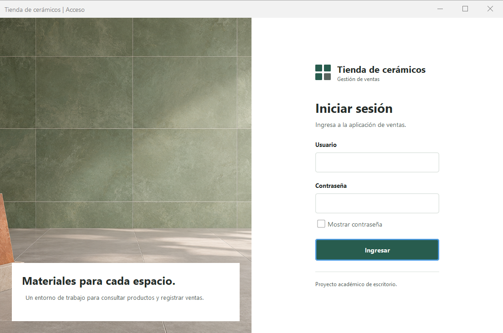](./recursos/actual/01-acceso.png) | [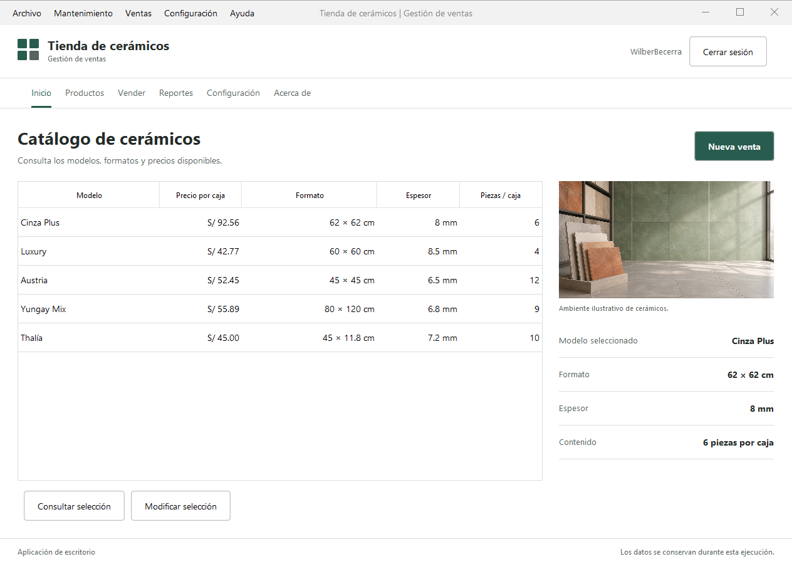](./recursos/actual/02-inicio.png) |

### Productos

| Consulta de un modelo | Modificación de características |
| :---: | :---: |
| [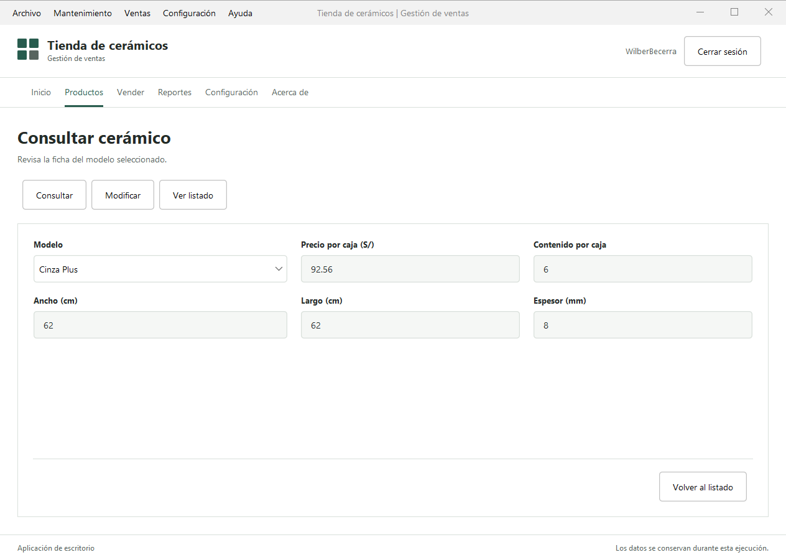](./recursos/actual/03-consultar.png) | [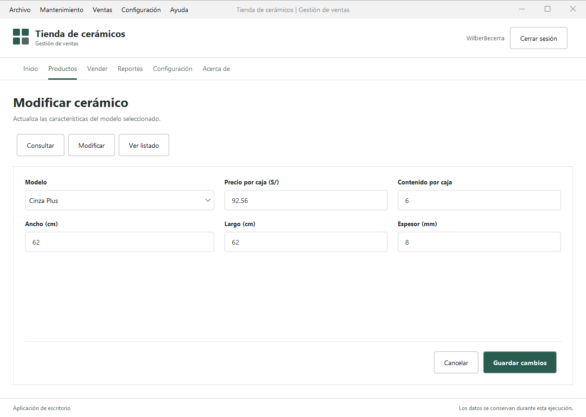](./recursos/actual/04-modificar.png) |

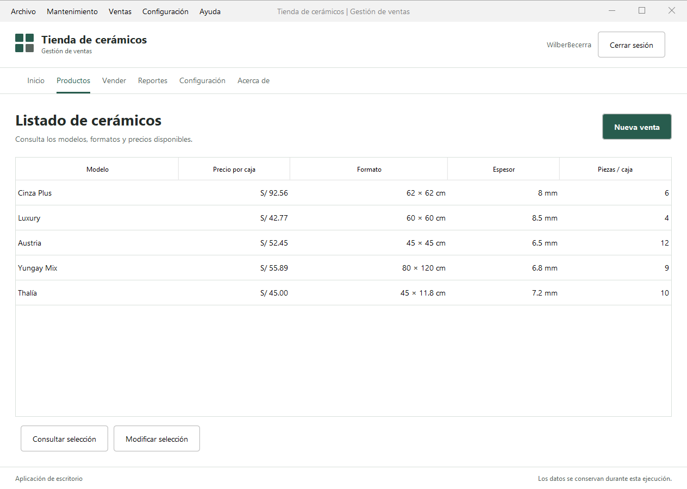

### Ventas y reportes

| Registro y resumen de venta | Resultados por modelo |
| :---: | :---: |
| [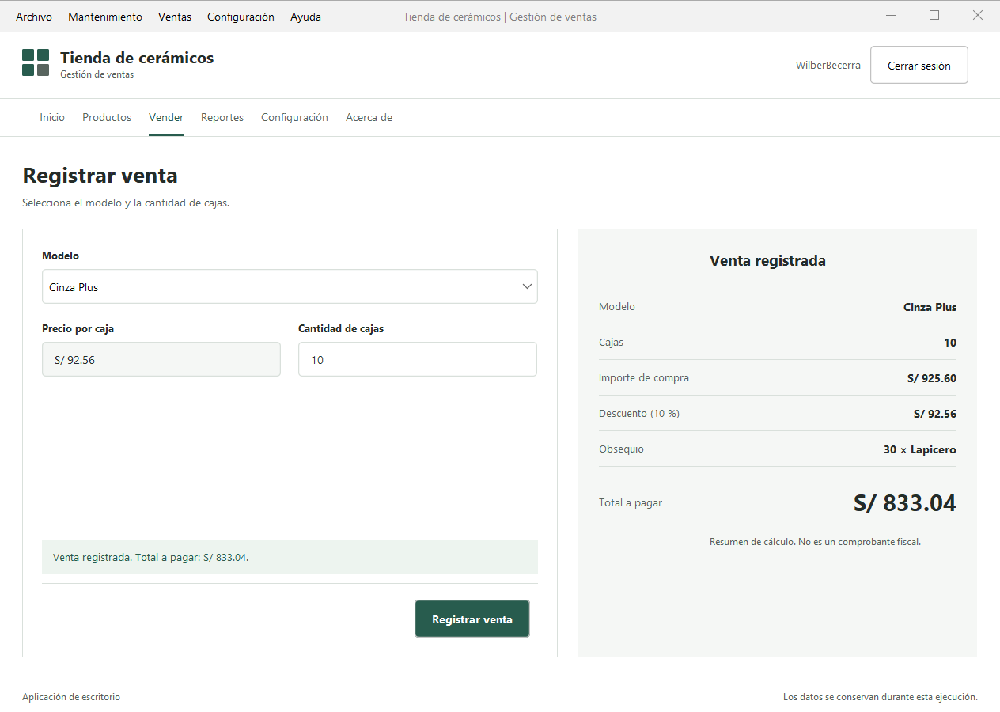](./recursos/actual/06-venta.png) | [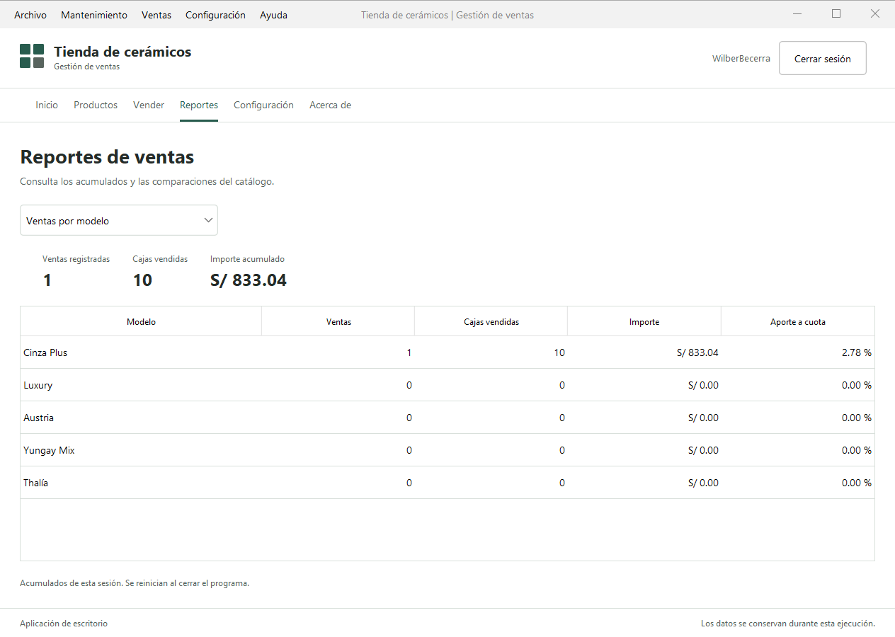](./recursos/actual/07-reportes.png) |

### Configuración

| Descuentos por cantidad | Obsequios |
| :---: | :---: |
| [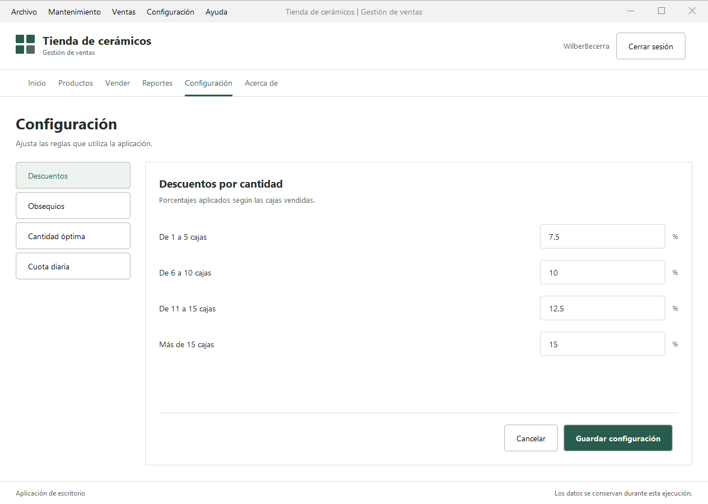](./recursos/actual/08-descuentos.png) | [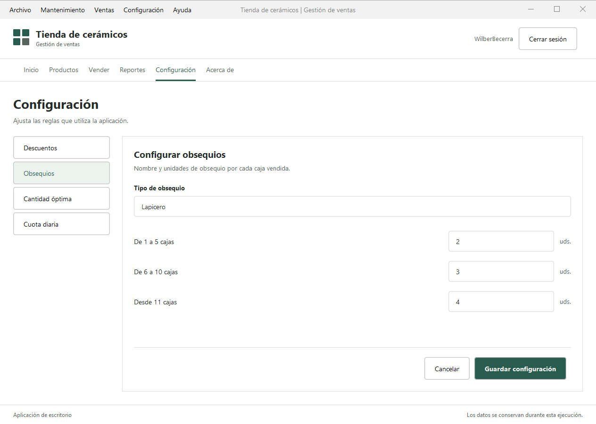](./recursos/actual/09-obsequios.png) |

| Cantidad óptima | Cuota diaria |
| :---: | :---: |
| [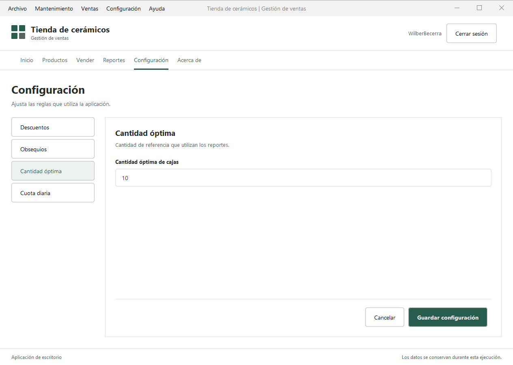](./recursos/actual/10-cantidad-optima.png) | [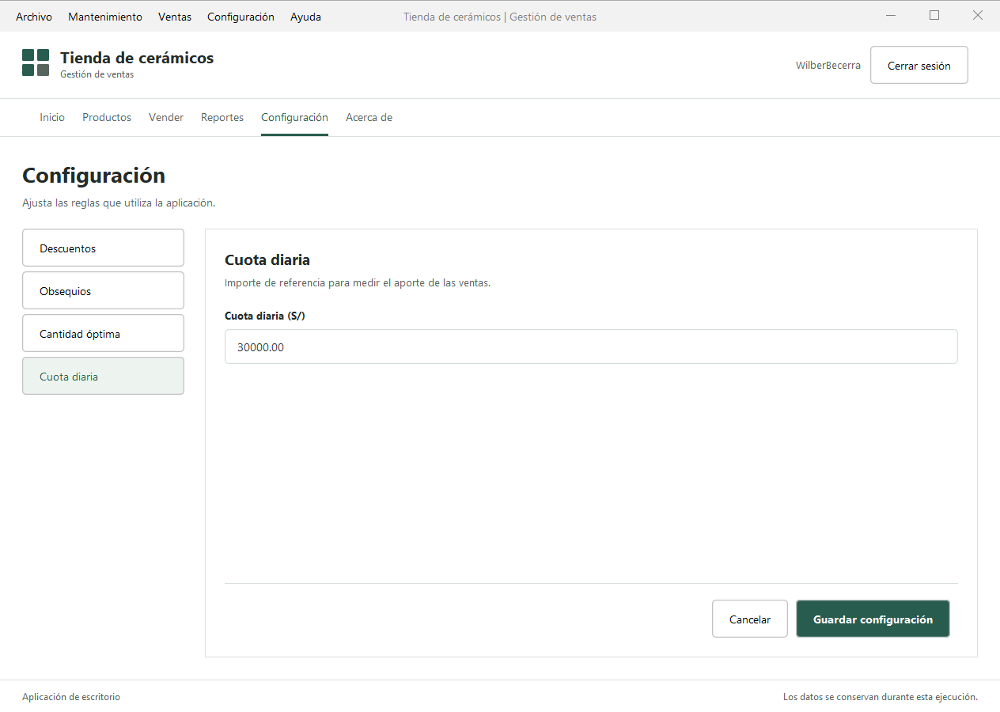](./recursos/actual/11-cuota-diaria.png) |

### Acerca de la aplicación

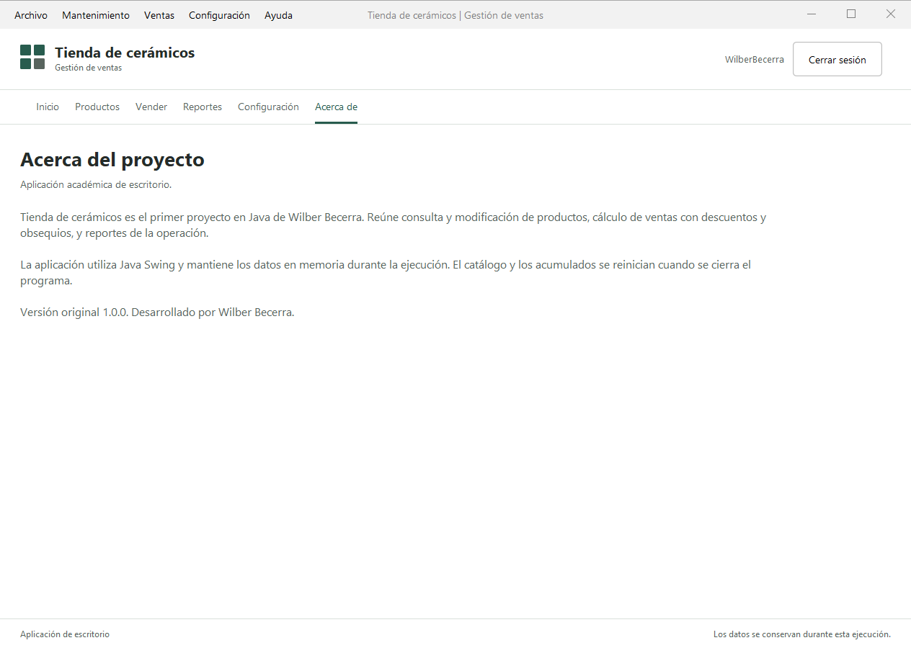

El ambiente cerámico utilizado en acceso e inicio es una imagen ilustrativa generada para la presentación; no corresponde a una tienda real ni a un modelo específico del catálogo.

## Tecnologías y organización

| Componente | Implementación |
| --- | --- |
| Lenguaje | Java, con compatibilidad de compilación Java 15. |
| Interfaz | Swing y administradores de distribución `BorderLayout`, `GridBagLayout` y `BoxLayout`. |
| Apariencia | FlatLaf 3.8, incluido en `lib/`. |
| Datos y reglas | `StoreModel`, `Product` y `SaleResult`; estado local en memoria y cálculo monetario con `BigDecimal`. |
| Entorno | Proyecto Eclipse; scripts de compilación y ejecución para PowerShell. |

```text
ProyectoTiendadeCeramicos/
├── lib/               # FlatLaf y su licencia
├── src/
│   ├── business/      # Modelo de datos, ventas y ventana principal
│   ├── ui/            # Acceso, vistas, componentes y tema compartido
│   ├── utils/         # Entradas de los diálogos de configuración
│   └── images/        # Imagen ilustrativa de la aplicación
├── tests/checks/      # Comprobaciones de reglas e interacción Swing
├── build.ps1          # Compilación, empaquetado y comprobaciones
└── run.ps1            # Compilación e inicio de la aplicación
recursos/actual/        # Imágenes de las vistas
```

Las reglas de negocio están separadas de la presentación. La ventana principal y los diálogos reutilizan las mismas vistas y el mismo estado de la sesión.

## Ejecución local

### Requisitos

- JDK 15 o posterior; compilación y comprobaciones verificadas con JDK 17.
- Eclipse IDE for Java Developers o PowerShell en Windows.
- Un entorno gráfico de escritorio para ejecutar Swing.

FlatLaf está incluido en el repositorio. No es necesario instalar Maven, Gradle ni un servidor de base de datos.

### Desde Eclipse

1. Clona el repositorio o descarga su contenido.
2. Selecciona **File → Import → General → Existing Projects into Workspace**.
3. Importa la carpeta `ProyectoTiendadeCeramicos`.
4. Asigna un JDK 15 o posterior en **Java Build Path** si Eclipse no reconoce el entorno JavaSE-15.
5. Ejecuta `src/ui/Login.java` con **Run As → Java Application**.

La configuración `.classpath` incluye la referencia a `lib/flatlaf-3.8.jar`.

### Desde PowerShell

```powershell
git clone https://github.com/wilberbecerra/gestor-tienda-ceramicos.git
Set-Location gestor-tienda-ceramicos/ProyectoTiendadeCeramicos
.\run.ps1
```

Los scripts utilizan `JAVA_HOME` si está definido; en caso contrario buscan las herramientas del JDK en `PATH`.

Para compilar, ejecutar las comprobaciones y generar las imágenes de las vistas:

```powershell
.\build.ps1 -Test
```

La compilación produce `build/ceramicos-app.jar` y `build/ceramicos-portable.zip`. Para iniciar el JAR, conserva la carpeta `build/lib` junto al archivo y ejecuta:

```powershell
java -jar build/ceramicos-app.jar
```

También puedes extraer el ZIP y abrir `Iniciar.bat`; requiere Java 15 o posterior instalado en el equipo.

### Cuenta de demostración

| Campo | Valor |
| --- | --- |
| Usuario | `WilberBecerra` |
| Contraseña | `1234` |

### Comprobaciones

El comando de pruebas comprueba los tramos de descuentos y obsequios, el cálculo de importes, las entradas inválidas, las configuraciones y los cinco modelos de los reportes. También verifica acciones sobre los controles Swing y genera las 12 vistas nativas en `build/capturas/`.

FlatLaf se distribuye con su [licencia Apache 2.0](./ProyectoTiendadeCeramicos/lib/flatlaf-LICENSE.txt).
